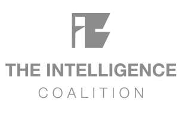

# The Intelligence Coalition

**Better decisions about AI. Better outcomes from AI.**

The Intelligence Coalition is an independent organization founded by Tom Rieger, Jason Greer, and Brad Kaufman. We bring together organizational, workforce, and technology perspectives to examine how AI changes decisions, work, risk, and performance.

We focus on what it takes to implement AI effectively and why initiatives succeed, stall, or create unintended consequences.

## What we examine

### Organization

Decision rights, incentives, operating models, governance, and organizational barriers.

### Workforce

Human–AI collaboration, trust, employee impact, expertise, and organizational readiness.

### Technology

AI architecture, model selection, agents, integration, evaluation, controls, and production deployment.

## Our approach

We examine AI as part of a connected system of people, work, organization, and technology. Each perspective informs and challenges the others.

Our work tests assumptions against real outcomes and examines the dependencies that determine whether AI succeeds in practice. We look at how work actually happens, who can question a system's output, and whether an implementation produces the intended results.

[Explore our principles](https://intelligencecoalition.com/principles)

## Research and resources

- [AI integration principles](https://intelligencecoalition.com/principles), the twelve principles guiding our work.
- [EU AI Act research](https://intelligencecoalition.com/eu-ai-act), covering obligations, implementation dates, and operational readiness.
- [EU AI Act Compliance Readiness Diagnostic](https://intelligencecoalition.com/eu-ai-act/readiness-diagnostic), a screening tool to identify areas that deserve further attention.
- [California AI governance research](https://intelligencecoalition.com/california-ai), covering selected requirements, deadlines, and readiness considerations.

## The Intelligence Coalition Podcast

Our podcast brings the Coalition's three perspectives into direct conversation about AI, organizational behavior, workforce dynamics, enterprise technology, and leadership. Episodes examine how AI changes work, expertise, risk, and performance.

[Explore the podcast](https://intelligencecoalition.com/podcast) · [Watch on YouTube](https://www.youtube.com/@TheIntelligenceCoalition)

## Founders

- **[Tom Rieger](https://nbi-consulting.com/)**, President, NBI Consulting. His work focuses on organizational barriers, behavioral economics, and organizational performance.
- **[Jason Greer](https://askjasongreer.com/)**, Founder and President, Greer Consulting. His work focuses on employee relations, workplace satisfaction, and labor relations.
- **[Brad Kaufman](https://bradkaufman.com/)**, CEO and Founder, Thoughtive. His work focuses on enterprise AI, system architecture, and technology implementation.

## Connect

[Website](https://intelligencecoalition.com) · [Podcast](https://intelligencecoalition.com/podcast) · [LinkedIn](https://www.linkedin.com/company/intelligence-coalition) · [YouTube](https://www.youtube.com/@TheIntelligenceCoalition) · [Contact](https://intelligencecoalition.com/contact)
